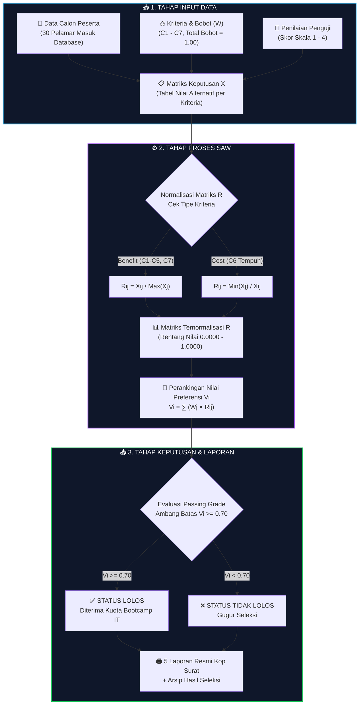
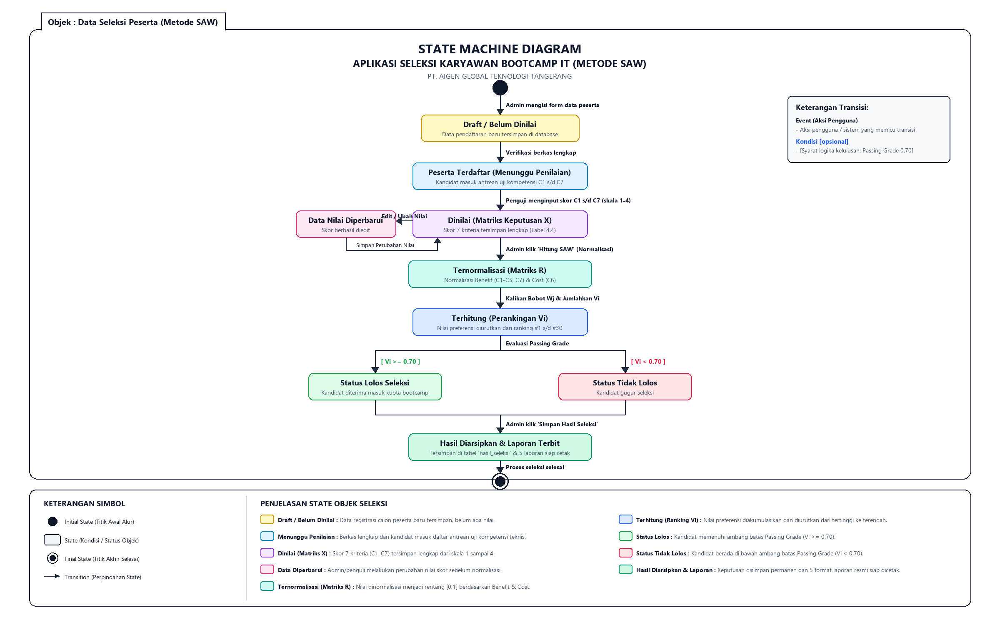

<div align="center">

<!-- BANNER HEADER HERO (Capsule Render) -->


<!-- ANIMATED TYPING SUBTITLE -->
<a href="#">
  
</a>

<!-- TECH STACK BADGES -->
<p align="center">
  
  
  
  
  
  
</p>

<!-- DYNAMIC METRICS BADGES -->
<p align="center">
  
  
  
  
  
</p>

**SPK SAW PT. Aigen Global Teknologi** adalah aplikasi web Sistem Pendukung Keputusan (*Decision Support System*) berbasis metode **Simple Additive Weighting (SAW)** yang dirancang untuk mengotomatisasi, menstandarisasi, dan meningkatkan transparansi proses seleksi penerimaan calon karyawan peserta Bootcamp IT. 

Sistem ini memproses penilaian multikriteria (7 kriteria teknis & non-teknis) terhadap seluruh kandidat pelamar, menghitung matriks normalisasi (*Benefit* dan *Cost*), mengalikan bobot preferensi objektif pimpinan, hingga menghasilkan perankingan kelulusan presisi berbasis *Passing Grade*.

> 📌 **Status Proyek:** Aplikasi web telah **100% selesai diimplementasikan (Fully Functional)**, dilengkapi basis data MySQL (30 data pelamar awal), visualisasi statistik interaktif Chart.js, 5 format laporan cetak resmi ber-Kop Surat, perancangan antarmuka Low-Fi/High-Fi, dan pemodelan siklus hidup **UML State Machine Diagram**.

</div>

---

## ✨ Fitur Unggulan

| | Modul / Fitur | Deskripsi Fungsional |
|:---:|---|---|
| 🔐 | **Multi-Role Authentication** | Hak akses berbasis peran (**Admin** & **Penguji**) dengan proteksi sesi aman dan enkripsi kata sandi. |
| 👥 | **Master Data Peserta** | Manajemen data pelamar kandidat bootcamp (NIK, Nama, Jenis Kelamin, Kontak, Pendidikan, dsb.) lengkap dengan 30 data riil. |
| ⚖️ | **Master Kriteria & Bobot** | Konfigurasi 7 kriteria seleksi ($C_1$ s/d $C_7$) dengan penentuan tipe kriteria (*Benefit* / *Cost*) dan pembagian bobot preferensi ($\sum W_j = 1.00$). |
| 📝 | **Penilaian Uji Kompetensi** | Workspace khusus penguji untuk menginput nilai performa kandidat (skala 1 s/d 4) tanpa melihat formula hitung. |
| 🧮 | **Kalkulasi Otomatis SAW** | Eksekusi instan 3 tahapan SAW: pembentukan Matriks Keputusan ($X$), Matriks Ternormalisasi ($R$), dan Nilai Preferensi ($V$). |
| 📊 | **Visualisasi Ranking (Chart.js)** | Grafik batang dinamis nilai preferensi per kandidat, memudahkan pimpinan membaca pemetaan skor secara visual. |
| 🏆 | **Evaluasi Passing Grade** | Penentuan otomatis status **Lolos** ($V_i \ge 0.70$) dan **Tidak Lolos** ($V_i < 0.70$) serta penyimpanan arsip riwayat seleksi. |
| 🖨️ | **5 Format Laporan Siap Cetak** | Modul cetak resmi dengan Kop Surat PT Aigen Global Teknologi Tangerang, tanggal dinamis, dan lembar tanda tangan Direktur/HRD. |

---

## 🔄 Alur Kerja Sistem (Pipeline SAW)



> ⚠️ **Business Rules Seleksi:** 
> 1. Skor penilaian tiap kriteria berada pada rentang **1.00 s/d 4.00** berdasarkan rubrik uji kompetensi teknis.
> 2. Kriteria $C_6$ (Waktu Tempuh) berkarakter **Cost** (semakin dekat lokasi tempat tinggal, semakin hemat waktu & biaya transportasi, nilai normalisasinya semakin tinggi).
> 3. Kandidat dengan nilai akhir $V_i \ge 0.70$ ditetapkan **Lolos Kuota Bootcamp IT**, sedangkan $V_i < 0.70$ dinyatakan **Gugur/Tidak Lolos**.

---

## 👤 Hak Akses & Matriks Peran (RBAC)

| Modul & Hak Akses | 👑 Administrator | 🧑‍🏫 Penguji Teknis |
|---|:---:|:---:|
| Login & Autentikasi Sistem | ✅ | ✅ |
| Kelola Manajemen Akun Pengguna | ✅ | ❌ |
| Master Data Peserta Pelamar (CRUD) | ✅ | 👁️ *(Lihat)* |
| Master Kriteria & Konfigurasi Bobot | ✅ | 👁️ *(Lihat)* |
| Input & Perubahan Nilai Uji Kompetensi | ✅ | ✅ |
| Hitung Normalisasi & Preferensi SAW | ✅ | ❌ |
| Simpan Hasil & Arsip Seleksi Akhir | ✅ | ❌ |
| Pratinjau & Cetak 5 Format Laporan Resmi | ✅ | ✅ |

---

## ⚖️ 7 Kriteria & Pembobotan Metode SAW

Kriteria dirumuskan bersama tim HRD dan Technical Lead PT. Aigen Global Teknologi Tangerang:

| Kode | Nama Kriteria Uji | Tipe Kriteria | Bobot Preferensi ($W_j$) | Persentase | Formula Perhitungan |
|:---:|---|:---:|:---:|:---:|:---|
| **$C_1$** | Tes Teori & Wawasan IT | **Benefit** | $0.10$ | $10\%$ | $R_{ij} = \frac{X_{ij}}{\max_k(X_{kj})}$ |
| **$C_2$** | Coding Praktik (Live Coding) | **Benefit** | $0.10$ | $10\%$ | $R_{ij} = \frac{X_{ij}}{\max_k(X_{kj})}$ |
| **$C_3$** | Problem Solving & Logika | **Benefit** | $0.15$ | $15\%$ | $R_{ij} = \frac{X_{ij}}{\max_k(X_{kj})}$ |
| **$C_4$** | Portofolio Proyek Aplikasi | **Benefit** | $0.20$ | $20\%$ | $R_{ij} = \frac{X_{ij}}{\max_k(X_{kj})}$ |
| **$C_5$** | Lama Pengalaman Terkait | **Benefit** | $0.20$ | $20\%$ | $R_{ij} = \frac{X_{ij}}{\max_k(X_{kj})}$ |
| **$C_6$** | Waktu Tempuh ke Kantor | **Cost** | $0.05$ | $5\%$ | $R_{ij} = \frac{\min_k(X_{kj})}{X_{ij}}$ |
| **$C_7$** | Sikap, Attitude, & Komunikasi | **Benefit** | $0.20$ | $20\%$ | $R_{ij} = \frac{X_{ij}}{\max_k(X_{kj})}$ |
| **TOTAL** | | | **$1.00$** | **$100\%$** | $V_i = \sum_{j=1}^7 W_j \cdot R_{ij}$ |

---

## 📐 Pemodelan UML: State Machine Diagram

Pemodelan siklus hidup (*lifecycle*) seleksi dirancang strictly mengikuti pedoman kurikulum **RPL 2026 (Slide 12 - Studi Kasus Acuan)**:

<div align="center">
  
  <p><em>Gambar: State Machine Diagram Siklus Hidup Seleksi Calon Karyawan Metode SAW (Objek: Data Seleksi Peserta)</em></p>
</div>

Siklus status meliputi 9 state utama:
1. `Draft / Belum Dinilai` $\rightarrow$ Registrasi pelamar tersimpan di database.
2. `Peserta Terdaftar (Menunggu Penilaian)` $\rightarrow$ Masuk antrean penilaian penguji.
3. `Dinilai (Matriks Keputusan X)` $\rightarrow$ Skor 7 kriteria tersimpan lengkap.
4. `Data Nilai Diperbarui (Edit Loop)` $\rightarrow$ Siklus koreksi nilai sebelum normalisasi dieksekusi.
5. `Ternormalisasi (Matriks R)` $\rightarrow$ Transformasi skala matriks benefit & cost $[0, 1]$.
6. `Terhitung (Perankingan Vi)` $\rightarrow$ Akumulasi nilai preferensi dan pengurutan peringkat $1$ s/d $30$.
7. `Status Lolos Seleksi` $[V_i \ge 0.70]$ vs `Status Tidak Lolos` $[V_i < 0.70]$.
8. `Hasil Diarsipkan & Laporan Terbit` $\rightarrow$ Penyimpanan permanen dan penerbitan 5 dokumen cetak.
9. `Final State` (⦿) $\rightarrow$ Proses seleksi periode aktif selesai.

---

## 🎨 Pratinjau Antarmuka & Wireframe

Desain antarmuka dirancang komparatif antara kerangka konseptual hitam-putih (*Low-Fidelity Wireframe*) dan antarmuka web modern (*High-Fidelity Implementation*):

| Menu Sistem | Wireframe Hitam-Putih (Low-Fi) | Implementasi Antarmuka Web (Hi-Fi) |
|---|:---:|:---:|
| **Dashboard Utama** | `wireframes/wf_03_dashboard.png` | Statistik Ringkasan & Quick Actions |
| **Data Peserta** | `wireframes/wf_04_peserta.png` | Tabel Interaktif Data 30 Pelamar |
| **Kriteria & Bobot** | `wireframes/wf_05_kriteria.png` | Pengaturan Parameter Kriteria SAW |
| **Input Penilaian** | `wireframes/wf_06_penilaian.png` | Form Input Skor Skala 1-4 Penguji |
| **Kalkulasi SAW** | `wireframes/wf_07_perhitungan.png` | Matriks X, Matriks R, & Nilai Vi |
| **Hasil & Grafik** | `wireframes/wf_08_hasil.png` | Chart.js Bar Chart & Status Kelulusan |
| **Menu Cetak Laporan** | `wireframes/wf_09_laporan_menu.png` | 5 Kartu Modul Laporan Resmi |

---

## 🛠️ Tech Stack & Arsitektur

| Komponen | Teknologi | Keterangan |
|---|---|---|
| **Bahasa Pemrograman** | PHP 8.2+ | Native Modular (Cepat, stabil, tanpa overhead framework berat) |
| **Basis Data** | MySQL / MariaDB | Relational Database Engine (`spk_saw_aigen`) |
| **Web Server** | Apache (XAMPP Environment) | Local Development & Deployment Server |
| **Styling & UI** | Bootstrap 5.3 + Custom CSS | Responsif, tata letak modern, Dark/Light friendly |
| **Ikonografi** | Font Awesome 6 Free + Bootstrap Icons | Visualisasi navigasi intuitif |
| **Data Visualization** | Chart.js 4.4 | Grafik batang interaktif nilai preferensi kandidat |
| **Mesin Cetak** | Native CSS `@media print` | Cetak presisi A4, Kop Surat otomatis, page-break aman |

<details>
<summary><b>🔐 Keamanan & Non-Functional Requirements (NFR)</b></summary>
<br/>

| ID | Kategori | Spesifikasi & Implementasi |
|---|---|---|
| **NFR-SEC-01** | Autentikasi | Enkripsi hashing kata sandi dan manajemen sesi aman via `session_start()` terisolasi |
| **NFR-SEC-02** | Proteksi Injeksi | Sanitasi input data string via `mysqli_real_escape_string()` dan validasi tipe data numerik |
| **NFR-SEC-03** | Hak Akses | Pengecekan sesi server-side di setiap header halaman (`$_SESSION['role']`) |
| **NFR-PERF-01** | Kecepatan Eksekusi | Perhitungan 30 alternatif $\times$ 7 kriteria selesai dalam waktu $< 50\text{ ms}$ |
| **NFR-USAB-01** | Standar Desain | Layout mengacu pada prinsip *Nielsen's 10 Usability Heuristics* |

</details>

<details>
<summary><b>📑 Spesifikasi 5 Format Laporan Resmi (Print Engine)</b></summary>
<br/>

1. **Laporan 1: Rekapitulasi Data Peserta** (`laporan_peserta.php`) — Berisi profil lengkap kandidat pelamar.
2. **Laporan 2: Parameter Kriteria & Bobot** (`laporan_kriteria.php`) — Pembagian bobot matematis SAW.
3. **Laporan 3: Matriks Penilaian Penguji** (`laporan_penilaian.php`) — Nilai mentah uji kompetensi teknis ($X$).
4. **Laporan 4: Hasil Normalisasi Matriks** (`laporan_seleksi.php`) — Matriks terhitung ($R$).
5. **Laporan 5: Hasil Akhir & Perankingan** (`laporan_ranking.php`) — Nilai preferensi ($V$), peringkat, dan status kelulusan resmi bertanda tangan Direktur PT Aigen Global Teknologi.

</details>

---

## 🚀 Panduan Instalasi & Menjalankan Sistem

Ikuti 3 langkah cepat untuk menjalankan aplikasi di komputer lokal:

### 1️⃣ Clone Repositori
Pindahkan atau *clone* repositori ke dalam folder direktori web server (htdocs XAMPP):
```bash
cd C:\xampp\htdocs
git clone https://github.com/USERNAME_ANDA/spk-saw-aigen.git
```

### 2️⃣ Pasang Database (Pilih Salah Satu Cara)

* **Cara A (Satu Klik via Browser - Direkomendasikan):**
  Buka browser dan akses URL:
  ```
  http://localhost/spk-saw-aigen/setup.php
  ```
  Klik tombol **"Jalankan Setup Database Otomatis"**. Database, tabel, dan 30 data kandidat awal akan dibuat secara otomatis!

* **Cara B (Manual via phpMyAdmin):**
  1. Buka `http://localhost/phpmyadmin/`.
  2. Buat database baru bernama `spk_saw_aigen`.
  3. Klik tab **Import** $\rightarrow$ Pilih file `database/spk_saw_aigen.sql` $\rightarrow$ Klik **Kirim / Import**.

### 3️⃣ Buka Aplikasi & Login
Buka browser pada alamat:
```
http://localhost/spk-saw-aigen/
```

**Kredensial Login Tersedia:**
| Peran Akun | Username | Password | Keterangan Hak Akses |
|:---:|:---:|:---:|---|
| **Admin** | `admin` | `admin123` | Akses penuh seluruh master data, hitung SAW, dan laporan |
| **Penguji** | `penguji` | `penguji123` | Akses workspace input nilai & pratinjau laporan |

---

## 📁 Struktur Direktori Proyek

```
spk-saw-aigen/
├── 📁 assets/               # CSS, JavaScript kustom, dan pustaka eksternal
├── 📁 database/             # Skrip SQL database (spk_saw_aigen.sql)
├── 📁 docs/                 # Dokumentasi teknis, screenshot implementasi, dokumen pendukung
├── 📁 wireframes/           # 16 Berkas mockup kerangka hitam-putih (Low-Fidelity PNG)
├── 📄 index.php             # Halaman login & portal autentikasi
├── 📄 dashboard.php         # Beranda utama ringkasan statistik sistem
├── 📄 pengguna.php          # Manajemen akun admin & penguji
├── 📄 peserta.php           # Master data calon karyawan bootcamp
├── 📄 kriteria.php          # Master 7 kriteria & konfigurasi bobot
├── 📄 penilaian.php         # Formulir input skor uji kompetensi teknis penguji
├── 📄 perhitungan.php       # Kalkulator logika SAW (Matriks X, R, dan preferensi V)
├── 📄 hasil.php             # Papan perankingan, evaluasi kelulusan, dan Chart.js
├── 📄 laporan.php           # Pusat portal 5 modul cetak laporan
├── 📄 laporan_peserta.php   # Template cetak resmi rekap peserta
├── 📄 laporan_kriteria.php  # Template cetak resmi kriteria
├── 📄 laporan_penilaian.php # Template cetak resmi matriks nilai
├── 📄 laporan_seleksi.php   # Template cetak resmi normalisasi
├── 📄 laporan_ranking.php   # Template cetak resmi kelulusan & tanda tangan pimpinan
├── 📄 koneksi.php           # Konfigurasi koneksi MySQL
├── 📄 setup.php             # Instalator database 1-klik otomatis
└── 📄 README.md             # Dokumentasi utama repositori
```

---

## 👥 Tim Pengembang

<div align="center">

| NPM | Nama Lengkap | Peran & Modul yang Dikembangkan |
|:---:|:---:|---|
| **202343501622** | **Raden Muhammad Prakoso** | 🧑‍💻 Project Lead, Algoritma SAW & Dokumentasi UI/UX |
| **202343501578** | **Muchammad Daffa Syaidan** | 🧑‍💻 Modul Manajemen Peserta & Parameter Kriteria |
| **202343501599** | **Muhammad Firmansyah** | 🧑‍💻 Modul Penilaian Penguji & Engine Cetak Laporan |

</div>

---

## 📚 Referensi Akademik & Rekayasa Perangkat Lunak

- **Fishburn, P. C. (1967)** — *Additive Utilities with Finite Sets: Axiomatic Foundations and Applications in Decision Making*.
- **MacCrimmon, K. R. (1968)** — *Decision Making Among Multiple-Attribute Alternatives: A Survey and Consolidated Approach*.
- **Pressman, R. S. (2014)** — *Software Engineering: A Practitioner's Approach (8th Edition)*. McGraw-Hill Education.
- **Sommerville, I. (2016)** — *Software Engineering (10th Edition)*. Pearson Education.
- **IEEE Std 29148-2018** — *ISO/IEC/IEEE International Standard — Systems and Software Engineering — Life Cycle Processes — Requirements Engineering*.
- **Materi Kuliah RPL UNINDRA (2026)** — *Pertemuan 05: UML State Machine Diagram*.

---

<div align="center">

<!-- WAVING FOOTER (Capsule Render) -->


**SPK SAW PT. Aigen Global Teknologi** • Rekayasa Perangkat Lunak 2026

*⭐ Star repository ini jika bermanfaat untuk studi atau pengembangan sistem pendukung keputusan Anda!*

</div>
